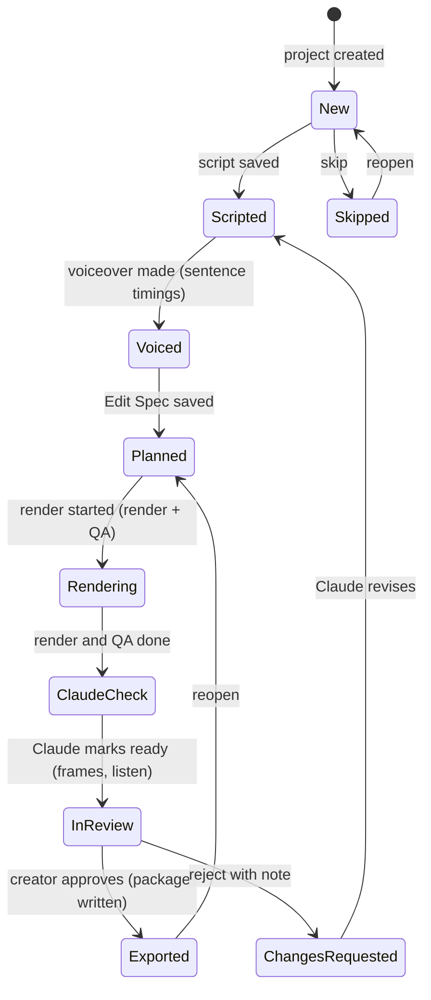

# Faceless Video Studio: build plan

Built from the docs in `docs/`: `Faceless Video Studio - Functional Specification v1.1.md` (FS), `Faceless Video Studio - Design Specification v1.1.md` (DS), `requirements.csv`, the four mockups and the README. Requirement IDs (LIB-1, MCP-3, AC-7 …) are the FS IDs. ADR numbers are the DS ADRs.

**Source of truth**: each requirement's priority and phase come from `docs/requirements.csv`; the lifecycle from the Mermaid state diagram in DS section 7; the roadmap from the table in DS section 11.2. The PDFs are not used for code (their tables extract jumbled and their diagrams are images).

---

## 0. What we are building, in one paragraph

A local Python service (the **core**) that owns a SQLite database, a job queue, FFmpeg, faster-whisper and the ElevenLabs connection. It exposes **24 MCP tools + 4 prompts** at `http://127.0.0.1:8787/mcp`, plus a thin **stdio proxy** (`fvs mcp`) that Claude Desktop launches. Claude never runs commands; it writes a versioned **Edit Spec** (JSON) whose shots are cued to narration sentences, and the core compiles it into one FFmpeg render. Claude "sees" through frames and storyboards and "hears" through transcripts and loudness charts. A **React web app** on the same port lets the creator watch Claude work, review renders, approve or reject them, and change settings. Approving writes an export package; posting to TikTok stays manual in v1.

---

## 1. The open questions become settings (README "Still to decide")

The README's open questions are not fixed in code. Video length, the daily budget and the export destination are **settings** that the creator changes at any time on the Settings screen (and Claude can read or change them with `fvs_settings`). The values below are only the defaults a fresh install starts with.

| # | Question | Setting key(s) | Default | Allowed values | Where it is used |
|---|---|---|---|---|---|
| 1 | Typical video length | `video.target_min_seconds`, `video.target_max_seconds` | 30, 45 | 5–180, min ≤ max | Script length estimate and `fit` (SCR-4), `fvs_script_save` / `fvs_voiceover_generate` "fits / too_long / too_short", planner pacing |
| 1b | Maximum length | `video.max_seconds` | 60 | 5–600, ≥ target max | Default `output.max_seconds` in new Edit Specs; validator rule; `SCRIPT_TOO_LONG` |
| 2 | Daily ElevenLabs budget | `voice.daily_budget_chars` | 20,000 | 0–10,000,000 (0 = no voice spending without `allow_over_budget`) | Budget check, dry runs, dashboard budget card |
| 2b | When the budget day starts | `voice.budget_reset_time` | 00:00 local | Any HH:MM | Summing today's spend from `cost_ledger` |
| 3 | Where approved videos go | `export.destination` | `folder` | `folder`, `folder_and_tiktok_draft` (option shown but disabled until EXP-3 ships in P5) | Exporter on approve |
| 3b | Output folder | `folders.output` (config.toml) | `~/FVS/output` | Any folder the creator picks | Exporter; added to the path allow-list |

Rules for these settings:
- Changing one never touches existing versions: specs and scripts already saved keep their own values; only new scripts, plans and batches use the new value. Exported projects never change.
- Every change is validated (range, min ≤ max) and recorded in the activity feed ("Creator changed the daily budget from 20,000 to 30,000").
- A budget change takes effect immediately for the next voice call, including inside a running batch.
- `fvs_guide` returns the current values, so Claude always plans against what the creator set.

**Target OS is not a setting**: it is a build decision. Windows 11 is built and tested first because this machine runs it; the code stays cross-platform (NFR-X1) so macOS can follow from the same codebase.

---

## 2. Tech stack (from ADR-2, ADR-3, ADR-4, ADR-5)

| Layer | Choice |
|---|---|
| Language / runtime | Python 3.12, managed with **uv** (one `pyproject.toml`) |
| Web / API | FastAPI + Uvicorn, bound to `127.0.0.1` only |
| Models / schemas | Pydantic v2: one set of models is the Edit Spec schema, the validator and the MCP tool schemas |
| MCP | Official `mcp` Python SDK, Streamable HTTP app mounted at `/mcp` inside FastAPI; stdio proxy as a separate entry point |
| DB | SQLite (WAL mode) through SQLAlchemy 2 Core or `sqlite3` + a small migration runner |
| Jobs | Own job queue: a `jobs` table plus an in-process worker pool (ADR-4). No Redis or Celery |
| Media | FFmpeg 7+ / ffprobe (gyan.dev "full" build on Windows: has libass, libx264, NVENC, QSV and AMF) |
| Speech recognition | faster-whisper, `small` model, int8, CPU |
| Images / charts | Pillow (contact sheets, safe-zone overlay, storyboards), matplotlib (loudness charts) |
| Fonts | Bundled OFL fonts (for example Inter, Montserrat, Anton) passed to libass with `fontsdir`. Nothing loaded from the internet (NFR-X1). `fontTools` for the missing-glyph check |
| HTTP client | httpx (ElevenLabs), with retry and backoff |
| Logging | structlog to JSON, rotated daily (NFR-O1) |
| CLI | Typer: `fvs serve`, `fvs mcp`, `fvs doctor`, `fvs open` |
| Web app | React + Vite + TypeScript, TanStack Query, SSE for live updates; styles from the mockups (Inter + Space Grotesk, `#F6F6F3` background, `#2B50E6` accent) |
| Tests | pytest, pytest-asyncio, an MCP SDK test client, MCP Inspector, Playwright for web smoke tests |

---

## 3. Repository layout

```
fvs/
  pyproject.toml
  src/fvs/
    cli.py               # fvs serve | mcp | doctor | open
    config.py            # ~/.fvs/config.toml, token, folder allow-list
    store/               # DB, migrations, repositories (fvs.store)
    jobs/                # queue, worker pool, restart recovery
    activity.py          # plain-language feed + SSE fan-out (fvs.activity)
    library/             # scan, hash, change detection (fvs.library)
    projects/            # projects, versions, lifecycle, reviews (fvs.projects)
    analyze/             # ffprobe, scenes, black/frozen, loudness, whisper (fvs.analyze)
    script/              # markup parser, sentences, estimate, lint (fvs.script)
    voice/               # ElevenLabs client, cache, ledger, budget (fvs.voice)
    spec/                # Edit Spec models, cue resolution, validator (fvs.spec)
    plan/                # planner (fvs.plan)
    compile/             # filter-graph builder + stages + ASS (fvs.compile)
    render/              # FFmpeg runner, progress, reuse (fvs.render)
    see/                 # frames, storyboard, listen, contact sheets (fvs.see)
    qa/                  # 8 checks (fvs.qa)
    export/              # package folder, .srt, cover (fvs.export)
    api/                 # REST + SSE for the web app (fvs.api)
    mcp/                 # tool registry, prompts, result shaping, errors (fvs.mcp)
    mcp_proxy/           # stdio <-> HTTP proxy (fvs.mcp_proxy)
    assets_bundled/      # fonts, 2 templates, caption styles, sample music
  web/                   # React + Vite app
  tests/
    unit/ compiler/ media/ perception/ contract/ eval/ fixtures/
```

---

## 4. Domain reference (to keep at hand while building)

### 4.1 Project lifecycle: 10 states

Exactly 10 states (DS section 7): New, Scripted, Voiced, Planned, Rendering, Claude check, In review, Changes requested, Exported, Skipped.



The diagram's transitions, as the state machine will implement them:

| From | Event | To |
|---|---|---|
| (none) | `fvs_project_create` | New |
| New | `fvs_script_save` | Scripted |
| New | review `skip` | Skipped |
| Skipped | review `reopen` | New |
| Scripted | voiceover job done | Voiced |
| Voiced | `fvs_edit_save` | Planned |
| Planned | `fvs_render` (render + QA job starts) | Rendering |
| Rendering | render and QA done | Claude check |
| Claude check | review `ready` (no failed QA check, or `override_qa` + note, QA-4) | In review |
| In review | review `approve` (package written from the reviewed render, no second render) | Exported |
| In review | review `reject` + note | Changes requested |
| Changes requested | Claude revises (`fvs_script_save`) | Scripted |
| Exported | review `reopen` | Planned |

"Going back" rules from DS section 7, which add these edges:
- A new script from any later state returns the project to **Scripted** and marks its voiceover and render stale. This covers Changes requested → Scripted in the diagram.
- A new Edit Spec returns the project to **Planned** (from Planned onward, since a spec needs sentence timings). So a fix that only touches the spec, such as a caption override, goes Changes requested → Planned with no new voice characters (AC-12).
- **Exported** projects never change: saves are refused until the project is reopened (→ Planned). This is my reading of "Exported projects are never changed" (UC-5) together with the reopen edge.
- Skip is only drawn from **New**; skip from other states is not in the diagram, so the state machine refuses it.

**Failure is a flag**, not a state: `failed` + `last_error` on the project; the state is kept, and a retry resumes from it.

### 4.2 The 24 tools by phase

P1 (22): `fvs_guide, fvs_library_scan, fvs_projects_list, fvs_project_create, fvs_project_get, fvs_clip_inspect, fvs_frames, fvs_storyboard, fvs_listen, fvs_script_save, fvs_voiceover_generate ($), fvs_edit_plan, fvs_edit_save, fvs_render, fvs_batch_run ($), fvs_job_get, fvs_job_cancel, fvs_project_review, fvs_project_restore, fvs_assets_list, fvs_asset_import, fvs_settings`
P2 (2): `fvs_template_save`, `fvs_show` (MCP Apps)
Prompts (P1): `process_folder`, `revise_video`, `review_queue`, `resume_batch`

### 4.3 Hard rules every tool must meet (MCP-1 … MCP-11)

- Returns within **20 s**; longer work becomes a job; `fvs_job_get` waits at most **15 s**.
- Result **< 1 MB**: single images ≤ 512 px, sheets ≤ 1024 px, JPEG/WebP; lists paged at 20 with a cursor; `response_format` = concise | detailed.
- Errors: `isError` + `{code, message, fix, example}` (DS 8.6 lists 17 codes).
- Idempotent: the same inputs never bill twice or start a duplicate job.
- Image tools return images + JSON text, **no structured block** (ADR-8). Other tools return summary + JSON text + structuredContent.
- `readOnlyHint` on read tools; "COSTS MONEY" in the descriptions of `$` tools.
- Never accept paths outside the configured folders, and never accept FFmpeg arguments.
- One activity-feed line per call.

---

## 5. Phase 1 build sequence (the core pipeline)

Phase 1 is most of the work: it alone yields finished, Claude-checked videos. It is split into 10 work packages (WP), ordered by dependency. Sizes are rough estimates for one developer (S ≈ 2–3 days, M ≈ 1 week, L ≈ 2 weeks).

```
WP0 Foundations ─┬─ WP1 Library+Analyzer ─┐
                 ├─ WP2 Script+Voice ─────┼─ WP3 Spec+Planner ─ WP4 Compiler+Renderer ─ WP5 Perception+QA ─┐
                 └─ WP8 Web app shell ────┘                                                                  ├─ WP6 MCP server ─ WP7 Lifecycle/Batch/Export ─ WP9 Acceptance
                                                                                                             ┘
```
WP1 and WP2 can run in parallel; the web app (WP8) can start against mocked API data once WP0 is done.

---

### WP0: Foundations (M)

> **Status, 2026-11-20: done.** 63 tests pass (`uv run pytest`), ruff is clean, and `fvs serve` / `fvs doctor` were checked live on this machine. Code is in `src/fvs/` (`config`, `pathguard`, `store/`, `settings`, `events`, `activity`, `jobs`, `logs`, `doctor`, `core`, `api/`, `cli`). Notes:
> - uv runs the installed Python 3.12.4. uv's own 3.12.16 downloaded, but its install failed to create the version link, so it isn't used.
> - Beyond DS 6.1, the `jobs` table has `idempotency_key` (MCP-6) and `cancel_requested` columns. Version tables (scripts, sentences, voiceovers, specs, reviews, ledger) are made insert-only with SQL triggers.
> - `fvs mcp` is a placeholder until WP6. The security checks already cover `/mcp`: it answers 401 without a token.
> - Dev setup: `uv sync`, then `uv run pytest`, `uv run fvs doctor`, `uv run fvs serve`, `uv run fvs open`.

**Build**
- uv project, lint (ruff), types (mypy or pyright), pytest, pre-commit.
- `config.py`: read and write `~/.fvs/config.toml` (folders, port, API key). On Windows, `~` = `%USERPROFILE%`; lock the file to the current user with an ACL (`icacls`, or `pywin32` `SetFileSecurity`). On macOS use `chmod 600` (NFR-S2).
- `~/.fvs/token`: a random 32-byte token created on first start.
- **Path guard**: `resolve_allowed(path, kind)` resolves symlinks and junctions, then checks against the allow-list (input, workspace, assets, output). Used by every component (NFR-S3, MCP-9).
- DB schema with migrations for every DS 6.1 table: `clips, projects, project_clips, script_versions, sentences, voice_sentences, voiceovers, edit_specs, renders, reviews, jobs, activity, assets, templates, caption_styles, voice_profiles, style_guide, cost_ledger, settings`. Version rows are insert-only.
- Workspace folder layout (DS 6.2).
- **Settings service**: a typed Pydantic `Settings` model (one field per key in section 1, plus template, voice, renders at once and safe-zone margins) with ranges and cross-field checks; defaults seeded into the `settings` table on first start; `get()` always reads the current value; `update()` validates, saves, writes an activity line and publishes a `settings_changed` event so the web app refreshes live.
- **Job queue**: `jobs` table + worker pool (renders at once = automatic → half the CPU cores). States: queued, running, done, failed, cancelled. Parent/child jobs for batches. On start, `running` jobs are re-queued once (`attempt + 1`) or failed cleanly; temp outputs are deleted (NFR-R1).
- **Atomic outputs helper**: write to `*.tmp`, then `os.replace`.
- Activity log + an in-process pub/sub that feeds SSE and `fvs_job_get` waits.
- structlog with a redaction filter that removes the API key from every log record (NFR-S2, AC-9).
- `fvs doctor`: FFmpeg ≥ 7, libass, libx264, encoders list, bundled fonts, Whisper model, ElevenLabs key (`/v1/user/subscription`), disk ≥ 20 GB, Claude Desktop config (DS 10.6).
- `fvs serve`: FastAPI on `127.0.0.1:8787` with the security middleware (below).

**Security middleware (shared by `/mcp` and `/api`)**: bearer token or session cookie required (401 without one); `Host` must be `127.0.0.1:8787` or `localhost:8787`, else 403; `Origin`, when present, must be the web app's own, else 403; POST must be `application/json`.

**Done when**: `fvs doctor` passes on the dev machine; unit tests for the path guard (traversal, `..`, symlink/junction escape), token checks and job restart recovery.

---

### WP1: Library and clip analysis (M) — LIB-1, LIB-2, ANA-1–7

**Build**
- `scan(folder, subfolders)`: `.mp4 .mov .m4v .mkv .webm`; open files read-only only. A clip ID is a full-file hash (BLAKE3 or xxh3-128), cached by `(path, size, mtime)`. The `clips.state` column (active, changed, missing) is created now, but detecting changed or missing clips and flagging their projects is **LIB-3, Should, P2**; P1 only registers new clips.
- Clip numbers (`#3`) assigned in registration order; tools accept a number or an ID.
- Analyzer, cached in `cache/<clip_hash>/`:
  - ffprobe → duration, resolution, fps (detect VFR), rotation, codecs, bitrate, has_audio (ANA-1).
  - Scene changes: `ffmpeg -vf "select='gt(scene,0.3)',showinfo"` (or PySceneDetect) (ANA-2).
  - `blackdetect` + `freezedetect` (ANA-3).
  - faster-whisper with word timestamps on the original audio (ANA-4).
  - `ebur128` integrated loudness (ANA-5).
  - 3×2 contact sheet with burned-in times (Pillow).
- Analysis runs as a job when it would take more than 15 s (ANA-7). Whisper is loaded lazily and unloaded when idle.

**Tests**: an ffprobe fixture for each of the 7 test clips (landscape, portrait, no sound, 4K, VFR phone, 8 s, 3 min); input-folder checksum unchanged after a scan (AC-9).

---

### WP2: Script and voice (L) — SCR-1–5, VO-1–7, NFR-C1, NFR-C2

**Script service**
- Markup parser: one sentence per line (else split at `.!?`); `[pause 0.8]` (0.1–3 s), `{caption|spoken}`, `*emphasis*`. Output per sentence: spoken text, caption tokens (with emphasis flags), `pause_after_s`.
- Language guard: refuse scripts not written with spaces between words (`LANGUAGE_UNSUPPORTED`).
- Length estimate: words ÷ the voice profile's words per minute (default about 150), compared with the `video.target_min_seconds`–`video.target_max_seconds` range and `video.max_seconds` read from settings at save time. Once a real voiceover exists, its duration replaces the estimate (FS 9.3).
- Hook ≤ 8 words; title, post caption, hashtags, language, notes, author.
- Each save inserts a new `script_versions` row and makes the voiceover and render stale.

**Voice service**
- Voice profiles (alias, voice_id, model_id, stability, similarity, style, speed, language, is_default).
- Cache key = hash(spoken_text, voice_id, model_id, settings). On a hit, reuse `voice/<key>.mp3` + timings for free (VO-4, AC-8).
- On a miss: `POST /v1/text-to-speech/{voice_id}/with-timestamps` with `previous_request_ids` (up to 3) where the model supports it (not Eleven v3, so the default profile uses Multilingual v2). Sentences of one project run in order; at most **2** requests at once overall (a global semaphore).
- Record billed characters (from the response header) in `cost_ledger`.
- Character timings → word timings; map spoken words back to caption words for `{a|b}` pairs.
- Join: concat the sentence audio + exact silence for pauses, shift timings, write one voice track (WAV 48 kHz internally) + `timings.json`.
- Budget: the limit is `voice.daily_budget_chars` from settings (read on every call, never cached); today's spend = sum of the ledger since `voice.budget_reset_time`. A dry run returns chars to bill (misses only), budget left, quota left and reset date (from `GET /v1/user/subscription`). A real call over budget → `BUDGET_EXCEEDED` unless `allow_over_budget`, which is recorded in the ledger and the activity feed.
- Error mapping and retries (DS 10.2): 429/5xx → 3 retries at 2, 4, 8 s (or Retry-After) → `VOICE_BUSY`; `invalid_api_key` → `VOICE_AUTH`; `quota_exceeded` → `VOICE_QUOTA`; `max_character_limit_exceeded` → `VOICE_TEXT_TOO_LONG`; 422 → `VOICE_INPUT_INVALID`. A failure never loses the script (NFR-R2).

**Tests**: parser cases, char→word timing, caption mapping, a cost-ledger test against a **mock ElevenLabs server** (an unchanged script bills 0; one changed sentence bills only that sentence; over budget without the flag is refused) — this is AC-8. One live smoke test behind an env flag.

---

### WP3: Edit Spec, validator and planner (L) — EDT-1–5, CAP-3 rules, OVL-1 field

**Edit Spec models** (DS 5.1, 5.2, P1 fields): `schema_version, project, template, output.max_seconds, timeline.segments[] {clip, in, cue, motion, transition_in, fit}, reframe, audio.{original, music, loudness}, captions {style, mode, max_words, position, overrides}, hook, end.tail_seconds, cover.at_seconds`. Pydantic with `extra="forbid"` so Claude can set only what the schema allows.

**Cue resolution** (DS 5.3):
1. Each sentence owns `[start_i, start_{i+1})`; the last slot ends at last word + `tail_seconds` (0.3–1.0).
2. `sentences [a,b]`, `words [from,to]`, `seconds d`, `until: end`.
3. Contiguous coverage with no gap or overlap; a fade overlaps two segments by its length.
4. Source end = `in + length × speed`; on overflow apply `fit` (`error` | `slow` ≥ 0.8× | `hold_last` | `loop`).
5. Snap every boundary to the 30 fps frame grid (needed for AC-6, "within one frame").
6. Rules: text inside the safe zone (margins from settings: top 108, bottom 320, left 60, right 120), hook ≤ 8 words, assets exist and are licensed, total ≤ max_seconds.
7. Every error has a JSON path + problem + fix, for example *"clip #7 has 3.1 s left after 14.0 s but sentences 2–3 need 4.3 s. Use an earlier in (≤ 12.8), set fit "slow", or cue fewer sentences."*

**Save**: full spec or patch (JSON Merge Patch, RFC 7386); dry run returns the resolved timeline; otherwise insert `edit_specs` with `spec_hash` = hash of canonical JSON + input hashes. Schema version + migration hook (NFR-M1).

**Templates**: two read-only built-ins (for example `storytime_dark@2` and one light style) = partial specs merged under the project's changes; caption styles (`bold_yellow` …) as named ASS styles.

**Planner** (`fvs_edit_plan`, not saved): for each sentence slot, pick a shot from the project's clips using the analysis: scene ranges long enough for the slot, not black or frozen, prefer variety (do not reuse a scene before the others are used), use the template's motion and pacing. Return the proposed spec + notes ("clip #7 is 1.2 s short for sentence 4").

**Tests**: table-driven cue-resolution tests, fit rules, error messages, patch merge, hash stability.

---

### WP4: Compiler and renderer (L) — RND-1–5, EDT-6–8, CAP-1–6, AUD-1–4, OVL-1

**Typed filter-graph builder**: nodes, labelled pads and auto-escaping, so labels and quoting are always right. One module per stage (NFR-M2).

**Stages** (DS 5.5):
1. Resolve (WP3).
2. Per segment: `trim`/`atrim`, `setpts`, speed, reframe (`center_crop` = crop + scale; `blur_fill` = split → scale + boxblur background, overlay foreground; `fit_bars`; `manual` with focus_x, focus_y, zoom), slow zoom or pan with scale+crop expressions (not zoompan), `fps=30`, `format=yuv420p`, rotation honoured, VFR normalised.
3. Join: `concat` for cuts, `xfade` with computed offsets for fades.
4. (P2 overlays go here.)
5. Captions: build one `.ass` from word timings — `word_highlight` with karaoke `\k` tags or per-word events, `chunks` (1–3 words), `line`; emphasis colour, overrides, hook text for the first N seconds, MarginL/R/V from the safe zone, auto-wrap. Apply last with `subtitles=...:fontsdir=...`. **Windows**: escape the drive colon in filter paths (`C\:/...`), or run FFmpeg with `cwd` = the project folder and use relative paths.
6. Audio: voice track; original audio per segment (mute | duck | keep); music from `start_at`, looped (`aloop`), trimmed, faded; ducking with `sidechaincompress` keyed by the voice (needs ≥ 10 dB drop, AC-5); `amix`; **loudness in two passes** — first an audio-only render of the mix with `loudnorm` measure (`print_format=json`), then the final pass with the measured values (`-14 LUFS`, `TP -1`).
7. Output: `1080×1920, 30 fps, libx264 -profile:v high -pix_fmt yuv420p, AAC 48 kHz, -movflags +faststart, -progress pipe:1`.

**Renderer**: `subprocess` with an argument list, never a shell (NFR-S4); parse `-progress` for live progress; cancel = terminate the process + delete the temp file; write `renders/<spec_hash>.tmp.mp4` → rename; keep the exact command, the stderr tail and timings in the job log; **reuse** an existing render when spec hash + input hashes match (RND-5). Classify FFmpeg failures (missing encoder, bad input, disk full) into `RENDER_FAILED` with a fix.

**Still-frame mode** (`at=t`): the same graph, video only, at 288×512, one frame per requested time (needed by `fvs_frames` with source `spec`, ≤ 3 s for 6 frames, NFR-P2).

**Tests**: compiler tests assert graph structure (inputs, stages, labels) per sample spec; media tests render the 7 clips and check ffprobe output (AC-2), loudness with `ebur128` (AC-3), ducking windows (AC-5), segment starts (AC-6).

---

### WP5: Perception and QA (M) — SEE-1–7, QA-1–4

**Perception service**
- `frames(source=clip|render|spec, times | range+count, safe_zone, captions)`: ≤ 6 frames at ≤ 512 px each, more → one contact sheet ≤ 1024 px. Safe-zone outline drawn with Pillow. Frame-accurate seek (`-ss` after `-i` on renders, or `select=eq(n,N)`) for AC-13.
- `storyboard(spec|render)`: one tile per segment (first frame after reframing), time range, clip, source time, first words of the sentence; ≤ 12 tiles per image, paged; image + JSON table.
- `listen(target)`: Whisper on the voice track or the render's audio; word alignment against the script (difflib on normalised words → missing, extra, changed); short-term loudness per stem (voice, music, original — rendered as separate stems or measured from the mix inputs) as one 1024×300 chart; silences > 0.7 s (`silencedetect`); clipped samples (`astats`); integrated loudness and true peak.

**QA service: 8 checks after every render**, each pass | warn | fail with measured value, limit and a fix naming the spec field:
1. Format (ffprobe).
2. Duration and tail: ends 0.3–1.0 s after the last word.
3. Loudness −14 ± 1 LUFS.
4. True peak ≤ −1 dBTP.
5. Voice complete: render transcript matches ≥ 95 % of the script words.
6. Captions inside the safe zone: render the ASS layer alone (libass on a transparent canvas) at sampled event times and check the bounding box of non-transparent pixels against the safe rectangle.
7. No black or frozen stretch > 0.5 s (`blackdetect`, `freezedetect` on the render).
8. No missing glyphs: every caption character exists in the chosen font's cmap (fontTools).

Plus a contact sheet stored per render (QA-3). Marking ready or approving with a failed check needs `override_qa` + note (QA-4).

**Tests**: AC-13 — frames match the requested times within one frame; a spec still matches the render at the same time (image similarity); the storyboard lists every segment; `fvs_listen` flags a sentence removed on purpose.

---

### WP6: MCP server and stdio proxy (L) — MCP-1–11, SEE-1, SEE-6, SEE-7

**Server** (in the core, Streamable HTTP at `/mcp`, JSON only):
- A tool registry with one decorator that adds: input/output schema from Pydantic, `#3` → ID resolution, the 20 s timeout guard (spills into a job), result shaping (summary + JSON text + structuredContent; image tools: images + JSON text only), size enforcement (< 1 MB; downscale/recompress images), paging (20 + `next_cursor`), `response_format`, error shaping `{code, message, fix, example}`, idempotency keys, and one activity-feed line.
- The 22 P1 tools (section 4.2), each a thin wrapper over the services. Highlights:
  - `fvs_guide`: workflow text, markup, Edit Spec JSON schema, templates, caption styles, voices, budget, quota, settings summary. The channel style guide is added to it in P2 (SCR-6 is Should, P2).
  - `fvs_project_get`: the whole project state in one call.
  - `fvs_job_get`: waits up to 15 s on the pub/sub for any listed job to change; sends MCP progress notifications if the client gave a progress token.
  - `fvs_settings`: read/change settings, including the video length, daily budget and export destination from section 1, with the same validation as the web app; every change is logged to the activity feed. The API key is never readable or writable here.
- 4 prompts with their arguments (FS 5.4).
- Tool descriptions written as in DS 8.7 (when to use, cost, what to do on each error). These are refined from the agent evaluation (WP9).

**stdio proxy** (`fvs mcp`): reads `~/.fvs/token`; if the core is not up, starts `fvs serve` detached and waits for health; then forwards JSON-RPC between stdin/stdout and `/mcp` with the bearer token. `CORE_UNAVAILABLE` → "Run fvs doctor".

**Tests (contract + security)**: MCP Inspector + an SDK test client: schemas valid, every result < 1 MB and < 20 s (AC-11), error shapes, `/mcp` without token → 401, foreign Origin → 403, bad Host → 403, FFmpeg flags and outside paths refused, API key never in any result, API response or log (grep the logs) — AC-9.

---

### WP7: Lifecycle, review, batch, export (M) — PRJ-1–5, BAT-1–4, EXP-1, CAP-7, QA-4

- Lifecycle state machine (section 4.1) in one place, with guarded transitions; the stale flags; the failure flag.
- `fvs_project_create`: one per clip, or several clips; series + part; number and slug.
- `fvs_project_review`: ready | approve | reject | skip | reopen, for one or many; note; `override_qa`. Every decision → a `reviews` row.
- `fvs_project_restore`: make an earlier script or spec version current (inserts nothing; moves the pointer and re-derives the state).
- `fvs_batch_run`: a parent job with child steps (voiceover → plan → render) per project; one failure sets that project's flag and the others carry on; budget enforced over the whole batch unless `allow_over_budget`.
- `fvs_projects_list`: filters by state, failed only, needs attention; shows review notes so Claude can act on rejections.
- Jobs survive Claude Desktop closing (they live in the core) and an app restart (WP0 recovery) — AC-10.
- **Exporter** on approve: `output/YYYY-MM-DD/YYYY-MM-DD_NN_slug/` with `video.mp4` (a copy of the reviewed render, no re-render), `caption.txt` (post caption + hashtags), `cover.jpg` (frame at `cover.at_seconds`), `captions.srt`, `project.json`.

**Tests**: fault injection (kill mid-render, close the MCP client mid-batch, bad key, used-up quota, full disk); restore; AC-12 (a caption override changes captions with 0 new characters); AC-14 (one project from 3 clips; 3 projects from one clip with different ranges).

---

### WP8: Web app (L) — REV-1–5

Build from `docs/mockups/*.html` (pixel reference) and `docs/screens/*.dc.html` (component source). Shared layout: top bar with the **F** logo, nav (Dashboard, Review queue + count, Templates, Assets, Settings), and the "Core running · Claude connected" status dot.

| Screen | Contents |
|---|---|
| **Dashboard** | Batch header; voice budget card (today used / budget, ElevenLabs left + reset date); 10 state counters; projects table (#, video + clip file, state chip + failed chip, "where it stands", length); "What Claude is doing" live feed; "Running now" job progress bars; "Needs attention" cards (failed jobs with job-log link, changes requested with the note) |
| **Project** | Breadcrumb; title + state; Reject with note / Approve and export; 9:16 player with a safe-zone toggle; storyboard rows (thumb, time range, clip @ source time, sentence text); "What Claude checked" (6 frames + transcript vs script, music under the voice, silences); quality checks list (8); script with version switcher + Restore; voice and edit summary (voice, characters billed/reused, template, reframe, captions, music); links to Edit Spec JSON and job logs |
| **Review queue** | "N waiting"; "Approve the N that passed every check"; cards with player, title, template · voice · clip count, QA summary (green or amber), Reject… / Approve or Approve with note… |
| **Settings** | ElevenLabs key (masked, last 4 only; Replace key; Save and test), **daily budget (characters)** and **budget day starts at**, plan quota; voice profiles (list, add, default); Connect Claude (config JSON, **Add to Claude Desktop** — on Windows writes `%APPDATA%\Claude\claude_desktop_config.json`, merging rather than overwriting; Copy config; local MCP address + token with Copy; the `claude mcp add` command); folders (input read-only, output); **export destination** (Save to output folder / also send to TikTok as draft, the second disabled with "coming later" until P5); video defaults (template, voice, **target length min–max seconds**, **maximum length seconds**, renders at once), with inline validation (min ≤ max ≤ maximum) and a Save button that confirms "Applies to new scripts and plans; existing versions keep their values"; safe-zone margins; system check (the `fvs doctor` results + Run again) |
| Templates / Assets | P1: read-only lists (assets with license; importing an asset is a tool, with a simple form later). Template editor is P5 |

- Live updates via one SSE stream (`/api/events`) for activity, job progress and state changes (REV-5).
- Auth: `fvs open` opens `http://127.0.0.1:8787/?t=<token>`; the server swaps it for an HttpOnly, SameSite=Strict session cookie and redirects (DS 10.1).
- Video playback: serve renders with HTTP Range support.
- The FastAPI app serves the built `web/dist`.

**Tests**: a Playwright walkthrough per screen at the gate (FS section 8: "Demonstration").

---

### WP9: Phase 1 acceptance (M)

- Traceability test: read `docs/requirements.csv` and fail if any P1 row has no test or code reference (each test names the requirement IDs it covers).
- Fixture set: the 7 clips (landscape, portrait, no sound, 4K, VFR phone, 8 s, 3 min) + 3 more to make 10.
- Run AC-1 end to end in Claude Desktop with `process_folder`: 10 clips → 10 projects In review, no manual editing.
- Automated: AC-2 to AC-14 in the media, perception, contract and fault-injection suites.
- **Agent evaluation (AC-15)**: write 15 realistic tasks (for example "put the drone shot under sentence 3 and zoom in at 0:07", "make #3 funnier", "the caption says 1000 instead of 1,000", "build a 3-part series from clip #2"); run Claude against the real server; ≥ 13 of 15 succeed. Read the transcripts and improve the tool descriptions and error fixes.
- Performance check against NFR-P1–P6 (render ≤ 60 s for a 60 s video in software; frames ≤ 3 s; storyboard ≤ 8 s; read tools ≤ 2 s p95; 20 clips ≤ 30 min).

**P1 gate**: AC-1 to AC-15 all pass.

---

## 6. Later phases

Scope and gates from DS section 11.2; requirement IDs from `requirements.csv`.

| Phase | Scope (requirement IDs) | Gate to leave the phase | Main work |
|---|---|---|---|
| **P1 Core pipeline and agent tools** | All P1 rows of `requirements.csv` (section 5) | AC-1 to AC-15 pass | WP0–WP9 |
| **P2 Templates and polish** | LIB-3 detect changed or missing clips, ANA-8 letterbox, SCR-6 channel style guide, EDT-11 templates + `fvs_template_save` with dry-run diff, AUD-5 music library with mood tags and licenses, OVL-2 text overlays, OVL-3 logo, OVL-4 cover text, OVL-5 image overlays, EXP-2 AI-label reminder, REV-6 creator edits script or captions, REV-7 side-by-side compare, SEE-8 `fvs_show` in-chat player (MCP Apps, web link fallback) | A template change re-plans only unexported projects, with a correct diff (UC-5) | Overlay compiler stage; template versioning and diff; music library UI |
| **P3 Advanced editing** | ANA-9 silences, SCR-7 two-voice scripts, EDT-9 zoom to point / freeze / speed, EDT-10 region blur, EDT-12 seamless loop, named crossfade styles (rest of EDT-8), AUD-6 original sound at full level, AUD-7 sound effects | Agent evaluation passes again with the new edit options | New schema fields + one compiler stage change each (NFR-M2) |
| **P4 Quality and speed** | RND-6 hardware encoding with libx264 fallback (on Windows: `h264_nvenc` → `h264_qsv` → `h264_amf`, one retry with libx264 on failure), VO-8 pronunciation dictionaries | Render time with hardware encoding ≤ 20 s (NFR-P1) | Encoder probing in doctor; benchmark suite |
| **P5 Extras, as needed** | LIB-4 folder watching, ANA-10 subject tracking for crop, OVL-6 progress bar and end card, EXP-3 TikTok draft upload, REV-8 template editor with live preview | (none) | TikTok developer app; tracking model |

---

## 7. Windows-specific notes (first target)

- Install FFmpeg 7 (gyan.dev full build) on PATH; `fvs doctor` checks `ffmpeg -filters` for `subtitles`/`ass` and `-encoders` for `libx264`.
- Paths: use `pathlib` everywhere; escape `C:` inside filter arguments for `subtitles=` (`C\:/…`) or use relative paths with FFmpeg's `cwd`.
- Config permissions: ACL to the current user only.
- Claude Desktop config: `%APPDATA%\Claude\claude_desktop_config.json`. `fvs` must be on PATH (installed with `uv tool install` or `pipx`) for `"command": "fvs"` to work; otherwise write the absolute path to `fvs.exe`.
- Proxy detaching the core: `subprocess.Popen(..., creationflags=DETACHED_PROCESS | CREATE_NEW_PROCESS_GROUP)`.
- Cancelling FFmpeg: send `q` on stdin first, then `terminate()`.
- Packaging later: a system-tray launcher (`pystray`) offering "Open FVS" and "Quit"; optional PyInstaller build.

---

## 8. Risks to watch while building

| Risk | Mitigation in this plan |
|---|---|
| Sentence-by-sentence voice sounds joined wrongly | Request stitching (`previous_request_ids`), a default model that supports it, A/B listening early in WP2 |
| Two-pass loudnorm + "one FFmpeg pass" | Measure on an audio-only mix pass (fast), then one full render; verified by AC-3 |
| Safe-zone check accuracy | Rasterise the ASS layer with libass rather than estimating text metrics |
| Tool results over 1 MB or over 20 s | One central result shaper + timeout guard in the registry; contract tests on every tool |
| Claude misuses tools | Agent evaluation loop (AC-15) from the first working end-to-end run, not only at the end |
| DNS rebinding on the local HTTP port | Host/Origin checks + token on every request (WP0 middleware) |
| FFmpeg builds differ | `fvs doctor` at start-up and in Settings |
| Assets without commercial rights | License required on import; unlicensed assets refused by the validator (`ASSET_UNLICENSED`) |

---

## 9. Notes on the source documents

- Priorities and phases in this plan were checked against `docs/requirements.csv`; the lifecycle against the Mermaid diagram in DS section 7; the roadmap against the DS section 11.2 table. An earlier draft read them from the PDFs and had these wrong, now fixed: LIB-3 (changed or missing clips) is P2, not P1; folder watching is LIB-4 (P5), not LIB-3; AUD-4 (music with start point, loop and fades) is Must P1, not P2; EDT-4 (patches, hash versions) and EDT-6 (reframe) are Must P1, not P2; P3's IDs are EDT-9 (zoom to point, freeze, speed) and EDT-10 (region blur), not EDT-8/EDT-9; SCR-6 (style guide) is P2, so `fvs_guide` returns it only from P2.
- When a requirement is added or changes, update `requirements.csv` first and this plan second. WP9 includes a traceability check that every P1 row of the CSV is covered by a work package.
- The roadmap has no dates (DS 11.2). The open questions it waited on are now settings (section 1), so they no longer block scheduling.

---

## 10. Suggested first two weeks

1. WP0 complete: repo, config, token, path guard, DB + migrations, job queue, `fvs serve`, `fvs doctor`.
2. Collect the 7 test clips into `tests/fixtures/` (outside the repo if large).
3. Spike the riskiest pieces as throwaway scripts: (a) ElevenLabs with-timestamps + stitching on 3 sentences, (b) one FFmpeg render with blur-fill + ASS word highlight + sidechain ducking + two-pass loudnorm, (c) the MCP SDK Streamable HTTP app mounted in FastAPI with the stdio proxy, connected to Claude Desktop with one dummy tool returning an image.
4. Start WP1 and WP2 in parallel.
