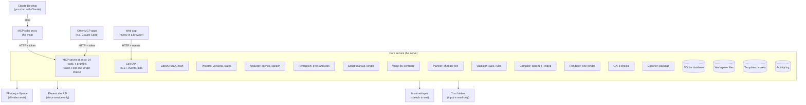
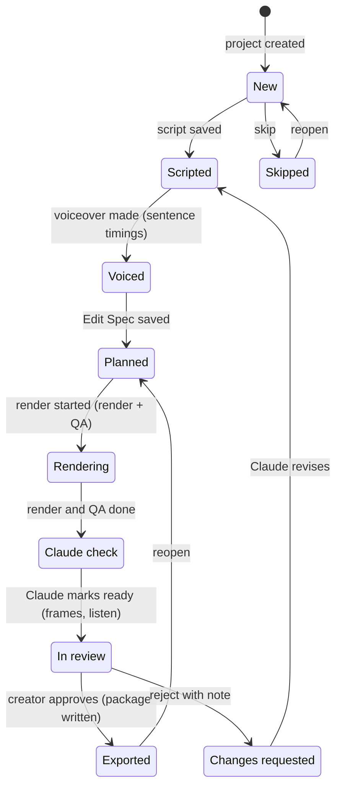
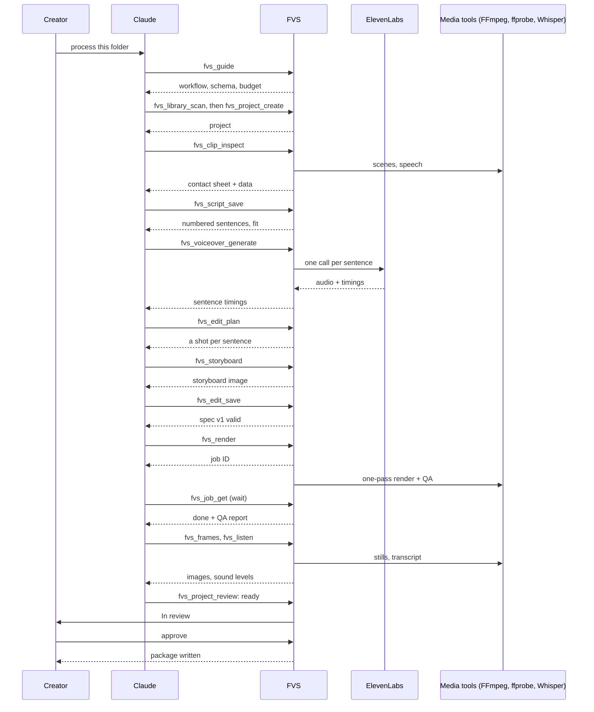

# Faceless Video Studio — Design Specification (v1.1)

Nov 20, 2026 · @Miguelson Antenor

FVS is a local core service that Claude drives as an agent through MCP tools, and the creator watches through a web app. Claude edits only by writing a versioned Edit Spec whose shots are timed to the narration; the engine compiles it into one FFmpeg pass. Claude checks its own work with tools that turn video into images and sound into text. This document explains how the system meets the Functional Specification (version 1.1).

## 1. Introduction

### 1.1 Purpose and scope

This Software Design Description covers FVS v1: architecture, components, data, interfaces and behaviour. It is organised by the design viewpoints of IEEE 1016-2009. Requirement IDs (LIB-1, SEE-2, MCP-3 and so on) refer to the Functional Specification. Version 1.1 applies the editing-task review and the consistency review of Nov 20, 2026.

### 1.2 Stakeholders and design concerns

| Stakeholder                          | Main concerns                                                                                                             |
|--------------------------------------|---------------------------------------------------------------------------------------------------------------------------|
| Creator                              | Finished videos with little effort; reviews before posting; spending under control; simple setup                          |
| Claude (agent)                       | Tools that cover every step; a way to see frames and "hear" sound; results it can act on; errors that say how to fix them |
| Developer (the creator, as engineer) | Easy to extend; testable; runs on one machine                                                                             |
| Platforms (TikTok, ElevenLabs)       | Correct output format; staying within rate limits and budget                                                              |

### 1.3 Viewpoints used

| Viewpoint (IEEE 1016)   | Where                                                                 |
|-------------------------|-----------------------------------------------------------------------|
| Context                 | Section 2 (creator, Claude, ElevenLabs, TikTok, folders)              |
| Composition and logical | Sections 2 and 4                                                      |
| Dependency              | Section 4 ("Talks to" column)                                         |
| Information             | Sections 5 and 6                                                      |
| Interface               | Sections 4.1, 5 and 8                                                 |
| Algorithm               | Sections 5.3 to 5.5 (cue resolution, voice pipeline, compiler stages) |
| State dynamics          | Section 7                                                             |
| Interaction             | Section 9                                                             |
| Resource                | Section 10                                                            |

Design decisions with their alternatives are recorded as ADRs in section 3.

## 2. Architecture overview

Three kinds of client reach one core service: Claude Desktop through the stdio proxy, other MCP apps directly at `/mcp`, and the creator through the web app. Only the core runs FFmpeg and Whisper, calls ElevenLabs or writes files. The creator posts the exported file to TikTok by hand.

**Diagram (architecture): Every client reaches one local core; Claude works only through its 24 tools**



Claude Desktop starts the proxy for each session; the core keeps running on its own, so renders, batches and the web app outlive the chat (ADR-3). The Perception service is how Claude sees frames and "hears" sound (ADR-8).

## 3. Design decisions (ADRs)

Twelve decisions shape the system. Each lists the option chosen, why, and what was rejected.

| ADR    | Decision                                                                                                                                                                                      | Why                                                                                                                                                                                                      | Rejected alternative                                                                                                |
|--------|-----------------------------------------------------------------------------------------------------------------------------------------------------------------------------------------------|----------------------------------------------------------------------------------------------------------------------------------------------------------------------------------------------------------|---------------------------------------------------------------------------------------------------------------------|
| ADR-1  | Claude edits only through a declarative **Edit Spec**; the engine compiles it                                                                                                                 | Validated before running; same spec gives the same video; testable; no command injection (RND-1, MCP-9)                                                                                                  | Claude writes FFmpeg commands (fragile, unsafe). One tool per edit operation (many calls, and each step re-encodes) |
| ADR-2  | **Python 3.12** core (FastAPI, Pydantic v2, official MCP Python SDK, SQLite, faster-whisper) and a **React + Vite** web app                                                                   | One set of Pydantic models gives the Edit Spec schema, its validation and the tool schemas; Whisper and audio analysis are native to Python                                                              | TypeScript core (would still need a Python sidecar for Whisper)                                                     |
| ADR-3  | The **core owns the MCP tools** and serves them over Streamable HTTP at `/mcp`. For Claude Desktop, `fvs mcp` is a thin stdio proxy to that address, and starts the core if it is not running | One tool implementation for both transports; renders and the web app outlive the chat (BAT-4)                                                                                                            | Tools inside the stdio process (renders die when the chat closes)                                                   |
| ADR-4  | Job queue stored in **SQLite**, with an in-process worker pool                                                                                                                                | One user, one machine; survives restarts                                                                                                                                                                 | Redis or Celery                                                                                                     |
| ADR-5  | Captions as an **ASS subtitle file** built from the voice's word timings, burned in with libass                                                                                               | Word highlight, outlines, exact positions, one filter; no speech recognition needed for captions                                                                                                         | drawtext per word                                                                                                   |
| ADR-6  | **One FFmpeg pass per render**, with loudness normalised in two passes (measure the mix, then apply)                                                                                          | Best quality and speed; accurate loudness (AUD-3)                                                                                                                                                        | Chains of intermediate files                                                                                        |
| ADR-7  | Our own **job tools** for long work                                                                                                                                                           | Works in every MCP client today                                                                                                                                                                          | MCP Tasks (experimental, moving to an extension)                                                                    |
| ADR-8  | **Tools only for Claude**: no MCP resources, no elicitation, no audio content. Image tools return images plus their data as JSON text                                                         | Claude Desktop reads resources only when the creator attaches them, has no elicitation, and Claude cannot hear (C-5, C-6); a reported Claude Code bug drops images when structured data is also returned | Resources for schema and project state; elicitation for cost questions                                              |
| ADR-9  | **One render per spec version**, at full quality; the reviewed file is the exported file                                                                                                      | No mismatch between what was approved and what is posted; one QA run; simpler lifecycle                                                                                                                  | A low-resolution preview plus a final render                                                                        |
| ADR-10 | **Sentence-level voice** with request stitching, sentence cache and pauses inserted as silence                                                                                                | Gives sentence timings for narration-timed edits, bills only changed sentences, makes pauses exact and model-independent                                                                                 | One request for the whole script; SSML break tags (not supported on Eleven v3 and v4, at most 3 s)                  |
| ADR-11 | **Segments are cued to sentences or words**; the engine works out their lengths                                                                                                               | Shots follow the narration even when the voice is regenerated with a different length                                                                                                                    | Fixed in/out times set by Claude                                                                                    |
| ADR-12 | Spending over budget needs an **`allow_over_budget` flag** that Claude sets after asking the creator, recorded in the activity feed                                                           | Simple, works for batches and overnight runs                                                                                                                                                             | Short-lived confirmation tokens                                                                                     |

## 4. Component design

The system has 18 components with one job each. Only the Analyzer, Perception service, Voice service (to join sentence audio and silences), Renderer and QA service run FFmpeg or Whisper, and only the Voice service talks to ElevenLabs.

| Component          | Package         | Responsibility                                                                                                                                                                                     | Talks to                         | Requirements                               |
|--------------------|-----------------|----------------------------------------------------------------------------------------------------------------------------------------------------------------------------------------------------|----------------------------------|--------------------------------------------|
| MCP stdio proxy    | `fvs.mcp_proxy` | Started by Claude Desktop; forwards MCP messages to `/mcp` with the session token; starts the core if needed                                                                                       | MCP server                       | MCP-10                                     |
| MCP server         | `fvs.mcp`       | Registers the 24 tools and 4 prompts; turns `#3` into IDs; shapes results and errors; serves Streamable HTTP at `/mcp` with token, Host and Origin checks                                          | All services, Activity log       | Section 5 of the FS                        |
| Core API           | `fvs.api`       | REST plus a live event stream for the web app; checks the session token                                                                                                                            | All services                     | REV-1–7                                    |
| Library            | `fvs.library`   | Scans folders, hashes files, registers clips, flags changed or missing ones                                                                                                                        | DB, file system                  | LIB-1–4                                    |
| Projects           | `fvs.projects`  | Projects, their clips, versions, lifecycle states, reviews, restore                                                                                                                                | DB                               | PRJ-1–5, QA-4, REV-3                       |
| Analyzer           | `fvs.analyze`   | ffprobe details, scenes, black and frozen stretches, loudness, letterbox, silences, Whisper transcript; caches by clip hash                                                                        | FFmpeg, faster-whisper           | ANA-1–10                                   |
| Perception service | `fvs.see`       | Frames at times from clips, renders or a spec (single-frame renders of the compiled graph); storyboards; contact sheets; "listen" (Whisper on the voiceover or render, word diff, loudness charts) | Compiler, FFmpeg, faster-whisper | SEE-1–8                                    |
| Script service     | `fvs.script`    | Script versions, markup parsing, sentence split, length estimate, style-guide lint                                                                                                                 | DB, Voice profiles               | SCR-1–7                                    |
| Voice service      | `fvs.voice`     | Sentence-level ElevenLabs calls with stitching, sentence cache, pauses as silence, timings, budget, quota, ledger                                                                                  | ElevenLabs API, FFmpeg, DB       | VO-1–8                                     |
| Planner            | `fvs.plan`      | Proposes an Edit Spec: assigns scenes to sentences, applies the template and fit rules                                                                                                             | Analyzer, Voice, Templates       | EDT-1, EDT-5                               |
| Validator          | `fvs.spec`      | Pydantic schema plus rules; cue resolution; every error with its path and a fix                                                                                                                    | Analyzer, Voice, Assets          | EDT-2–4                                    |
| Compiler           | `fvs.compile`   | Edit Spec → render plan: inputs, filter graph, ASS file, output settings                                                                                                                           | Assets, Voice                    | RND-1, EDT-6–12, CAP-1–7, AUD-1–7, OVL-1–6 |
| Renderer           | `fvs.render`    | Runs FFmpeg as an argument list; progress; temp file then rename; command log; reuses renders by hash                                                                                              | FFmpeg                           | RND-2–6                                    |
| QA service         | `fvs.qa`        | The 8 checks, contact sheet, report with pass, warn or fail                                                                                                                                        | FFmpeg, Perception service       | QA-1–4                                     |
| Exporter           | `fvs.export`    | Package folder, file names, .srt, cover, AI-label reminder                                                                                                                                         | File system                      | EXP-1–3                                    |
| Stores             | `fvs.store`     | Templates, assets with licenses, voice profiles, style guide, settings; API key in the local config file                                                                                           | DB, config file                  | AUD-5, OVL-3, VO-5, SCR-6, REV-4           |
| Activity log       | `fvs.activity`  | One plain-language line per tool call and per job event, streamed to the web app                                                                                                                   | DB, Core API                     | MCP-11, REV-1                              |
| Web app            | `web/`          | Dashboard, project page, review queue, settings                                                                                                                                                    | Core API                         | REV-1–8                                    |

### 4.1 Key internal interfaces

``` python
class VoiceService(Protocol):
    def generate(self, project: Project, profile: VoiceProfile, *, dry_run: bool,
                 allow_over_budget: bool) -> Voiceover | CostEstimate: ...
    # Voiceover.sentences: list[SentenceTiming(i, text, start, end, words)]

class Planner(Protocol):
    def propose(self, project: Project, template: Template,
                changes: dict | None) -> tuple[EditSpec, list[PlanNote]]: ...

class Validator(Protocol):
    def resolve(self, spec: EditSpec) -> ResolvedTimeline | list[SpecError]: ...
    # ResolvedTimeline.segments: list[(out_start, out_end, clip, src_in, src_out, sentences)]

class Compiler(Protocol):
    def compile(self, timeline: ResolvedTimeline, at: float | None = None) -> RenderPlan: ...
    # at=None: full render; at=t: a single frame (used by fvs_frames, source "spec")

class Perception(Protocol):
    def frames(self, source: FrameSource, times: list[float], safe_zone: bool) -> list[Image]: ...
    def storyboard(self, timeline: ResolvedTimeline) -> tuple[Image, list[dict]]: ...
    def listen(self, audio: Path, script: Script | None) -> ListenReport: ...
```

## 5. Edit Spec, voice pipeline and compiler

The Edit Spec is the contract between Claude and the engine: Claude can set anything the schema allows and nothing else. Shots are cued to the narration, so Claude says *which* shot plays under *which* sentence, and the engine works out the exact times.

### 5.1 Edit Spec v1, example

``` json
{
  "schema_version": 1,
  "project": 3,
  "template": "storytime_dark@2",
  "output": { "max_seconds": 60 },
  "timeline": {
    "segments": [
      { "clip": 3, "in": 2.0,  "cue": { "sentences": [1] },       "motion": "zoom_in" },
      { "clip": 3, "in": 21.0, "cue": { "sentences": [2] } },
      { "clip": 7, "in": 5.0,  "cue": { "sentences": [3, 5] },    "transition_in": { "type": "fade", "seconds": 0.3 } },
      { "clip": 3, "in": 31.0, "cue": { "until": "end" } }
    ]
  },
  "reframe": { "mode": "blur_fill", "focus_x": 0.5, "focus_y": 0.5, "zoom": 1.0 },
  "audio": {
    "original": { "mode": "duck", "duck_db": -14 },
    "music": { "asset": "ambient_03", "start_at": 12.0, "gain_db": -18, "duck": true, "fade_out": 1.5 },
    "loudness": { "target_lufs": -14, "true_peak_db": -1 }
  },
  "captions": { "style": "bold_yellow", "mode": "word_highlight", "max_words": 3,
                "position": "lower_third", "overrides": [ { "word": 14, "text": "1,000" } ] },
  "hook": { "text": "Nobody expects this from a volcano", "seconds": 2.5 },
  "end": { "tail_seconds": 0.6 },
  "cover": { "at_seconds": 1.2 }
}
```

### 5.2 Field reference

| Field                                                       | Allowed values                                                                                          | Phase |
|-------------------------------------------------------------|---------------------------------------------------------------------------------------------------------|-------|
| `segments[].clip`, `in`                                     | Any clip of the project; start time in that clip                                                        | P1    |
| `segments[].cue`                                            | `{"sentences":[a,b]}`, `{"words":[from,to]}`, `{"seconds":d}`, `{"until":"end"}`                        | P1    |
| `segments[].motion`                                         | `none`, `zoom_in`, `zoom_out`, `pan_left`, `pan_right`                                                  | P1    |
| `segments[].transition_in`                                  | `cut`, or `{"type":"fade","seconds":s}`; named crossfade styles in P3                                   | P1    |
| `segments[].fit`                                            | `error` (default), `slow` (≥ 0.8×), `hold_last`, `loop` when the clip is too short                      | P1    |
| `reframe`                                                   | `mode`: `center_crop`, `blur_fill`, `fit_bars`, `manual`; `focus_x`, `focus_y` (0–1); `zoom` (1–2)      | P1    |
| `audio.original.mode`                                       | `mute`, `duck`, `keep`                                                                                  | P1    |
| `audio.music`                                               | `asset`, `start_at`, `gain_db`, `duck`, `fade_in`, `fade_out` (loops when short)                        | P1    |
| `captions`                                                  | `style`, `mode` (`word_highlight`, `chunks`, `line`, `off`), `max_words` (1–3), `position`, `overrides` | P1    |
| `hook`, `cover.at_seconds`, `end.tail_seconds` (0.3–1.0)    | As in the example                                                                                       | P1    |
| `overlays[]`                                                | `type` `text` or `image`, `text` or `asset`, `style`, `position`, `from` and `to` as cues               | P2    |
| `cover.text`, `logo`                                        | Cover text; logo asset, position, opacity                                                               | P2    |
| `segments[].zoom_to`, `freeze`, `speed`, `original_gain_db` | Zoom to a point, freeze frame, speed, original sound at full level                                      | P3    |
| `cleanup[]`, `sfx[]`, `end.loop_to_start`                   | Blur regions; sound effects at cues; seamless loop                                                      | P3    |

### 5.3 Cue resolution and validation

The voiceover's sentence timings define the output timeline: the video lasts from 0 to the end of the last word plus the tail.

1.  Each sentence owns a slot from its start to the next sentence's start, so pauses belong to the sentence before them. The last slot ends at the last word plus `tail_seconds`.

2.  A `sentences` cue covers the slots from sentence a to sentence b. A `words` cue runs from the first word's start to the start of the word after the last one. A `seconds` cue runs for that long from the end of the previous segment. `until: end` runs to the end of the timeline.

3.  Segments must follow each other with no gap or overlap and cover the whole timeline. A fade overlaps the two segments by its length.

4.  Each segment's source end is `in + length × speed`. If that passes the clip's end, the segment's `fit` decides; with `error`, the validator names the shortfall and the options (EDT-5).

5.  Rules: all text sits inside the safe zone (keep clear of the top 108 px, bottom 320 px, left 60 px and right 120 px of a 1080×1920 frame; the margins are a setting); the hook has 8 words or fewer; every asset exists and has a license; the total stays within `max_seconds`.

6.  Every error is returned with its JSON path, the problem and a fix, for example: `timeline.segments[1]: clip #7 has 3.1 s left after 14.0 s but sentences 2–3 need 4.3 s. Use an earlier in (≤ 12.8), set fit "slow", or cue fewer sentences.`

A dry run of `fvs_edit_save` returns the resolved timeline: for each segment, its output start and end, clip, source times and the text spoken over it.

### 5.4 Script markup and voice pipeline

Scripts use one sentence per line. Markup: `[pause 0.8]` adds 0.1–3 s of silence; `{1,000|one thousand}` shows the first form in captions and sends the second to the voice; `*word*` marks caption emphasis; `[voice: alias]` (P3) switches voice for a line.

1.  Parse the script into sentences, each with its spoken text, caption text, pauses and emphasis.

2.  For each sentence, build a cache key from the spoken text, voice ID, model and settings. A cache hit is reused at no cost.

3.  For each miss, call `POST /v1/text-to-speech/{voice_id}/with-timestamps` with the spoken text and, where the model allows, the request IDs of the previous sentences (up to 3) for stitching. Calls for one project run in order, because stitching needs the earlier requests to have finished; at most 2 run at once across projects.

4.  Record the characters billed per call in the ledger (the response headers report the character cost).

5.  Turn the character timings into word timings, and map spoken words back to caption words for `{display|spoken}` pairs.

6.  Join the sentence audio with the requested silences, shift all timings, and save one voice track plus a timings file.

7.  Return each sentence's start and end, the total length, whether it fits, the characters billed and reused, and the budget and quota left. Quota comes from `GET /v1/user/subscription` (`character_limit` minus `character_count`, and the reset time).

### 5.5 Compiler stages

1.  **Resolve**: load the spec and run cue resolution (5.3).

2.  **Video per segment**: trim and reset timestamps (`trim`, `setpts`); speed; reframe (`crop` and `scale`, or `split` → `boxblur` background + `overlay` foreground); slow zoom or pan (scale and crop expressions, which move more smoothly than `zoompan`); freeze (`tpad`); normalise frame rate and pixel format.

3.  **Join**: `concat` for cuts, `xfade` with computed offsets for fades.

4.  **Cleanup and overlays**: blurred regions, logo and image overlays with timed `enable` windows.

5.  **Captions, hook and text overlays**: one `.ass` file from the word timings (karaoke highlight tags, emphasis colours, overrides, safe-zone margins), applied last with the `subtitles` filter.

6.  **Audio**: voice track; original sound per segment; music from `start_at`, looped, trimmed and faded; ducking with `sidechaincompress` keyed by the voice; `amix`; `loudnorm` in two passes (measure the mixed audio, then apply).

7.  **Output**: 1080×1920, 30 fps, H.264 High, yuv420p, AAC 48 kHz, `+faststart`, with `-progress pipe:1` for live progress.

For still frames (`fvs_frames` with source `spec`), the same graph runs video-only at 288×512, inside the 512 px image limit of MCP-4, and outputs one frame per requested time. The graph is built with a small typed builder so labels and escaping are always right, and each stage is a module (NFR-M2).

## 6. Data model

All state lives in one SQLite file plus a workspace folder. Clips and projects are separate, so one video can use several clips and one clip can feed several videos. Scripts, voiceovers and Edit Specs are versions that are never changed.

### 6.1 Tables

| Table             | Key fields                                                                                                                                                          | Notes                                                                |
|-------------------|---------------------------------------------------------------------------------------------------------------------------------------------------------------------|----------------------------------------------------------------------|
| `clips`           | id, number, path, file_name, content_hash, duration_s, width, height, fps, has_audio, state (active, changed, missing)                                              | One row per source file                                              |
| `projects`        | id, number, title, slug, series, part, state, template, script_v, voiceover_id, spec_v, render_id, failed, last_error, stale_flags                                  | One row per video to publish; `state` follows section 7              |
| `project_clips`   | project_id, clip_id, position                                                                                                                                       | Which clips a project may use                                        |
| `script_versions` | project_id, version, title, voiceover_text, hook, post_caption, hashtags, language, notes, est_seconds, author (claude or creator)                                  | Never edited, only added                                             |
| `sentences`       | script_version_id, i, spoken_text, caption_text, pause_after_s, emphasis                                                                                            | Parsed from the markup                                               |
| `voice_sentences` | cache_key, voice_alias, model_id, audio_path, alignment_path, duration_s, chars_billed, request_id                                                                  | The sentence cache (VO-4)                                            |
| `voiceovers`      | id, project_id, script_version, voice_alias, audio_path, timings_path, duration_s, chars_billed, chars_reused                                                       | One voice track with sentence and word timings                       |
| `edit_specs`      | project_id, version, spec_json, spec_hash, schema_version, template_version                                                                                         | `spec_hash` identifies renders                                       |
| `renders`         | id, project_id, spec_hash, path, duration_s, bytes, qa_report, contact_sheet_path, command_log                                                                      | One per spec hash                                                    |
| `reviews`         | project_id, at, decision, note, by (creator or claude), qa_override                                                                                                 | Every review decision, kept as history                               |
| `jobs`            | id, kind (analyze, voice, render, export, batch), project_id, parent_id, state, progress, attempt, payload, result, error_code, error_message, fix_hint, timestamps | A batch is a parent job                                              |
| `activity`        | at, project_id, source (claude, creator or engine), tool, summary                                                                                                   | Feeds the dashboard (MCP-11)                                         |
| `assets`          | id, kind (music, font, logo, image, sfx), name, path, duration_s, tags, license, source_url                                                                         | No license, no use                                                   |
| `templates`       | name, version, description, defaults_json                                                                                                                           | Partial Edit Specs; P1 ships two read-only templates                 |
| `caption_styles`  | name, style_json                                                                                                                                                    | Named ASS styles such as `bold_yellow`                               |
| `voice_profiles`  | alias, voice_id, model_id, settings_json, language, is_default                                                                                                      | Created in Settings                                                  |
| `style_guide`     | version, guide_json                                                                                                                                                 | Tone, audience, call-to-action rules, banned words                   |
| `cost_ledger`     | at, chars, cache_key, project_id, over_budget_approved                                                                                                              | Today's spending is summed from here                                 |
| `settings`        | key, value_json                                                                                                                                                     | Defaults, budget, maximum length, safe-zone margins, renders at once |

Folder paths, the port and the API key live in `~/.fvs/config.toml`, not in the database.

### 6.2 Folder layout

``` text
~/.fvs/config.toml              # folders, port, API key (user-only permissions)
~/.fvs/token                    # local session token
~/FVS/
  input/                        # creator's clips; FVS never writes here (LIB-2)
  workspace/
    fvs.db
    logs/fvs.log                # structured log, rotated daily
    cache/<clip_hash>/          # probe.json, analysis.json, frames/, transcript.json
    voice/<cache_key>.mp3       # sentence cache, with <cache_key>.json timings
    projects/<NN>-<slug>/
      voice/                    # voiceover track and timings per version
      specs/                    # v1.json, v2.json …
      captions/                 # <spec_hash>.ass
      renders/                  # <spec_hash>.mp4, contact sheets
      logs/                     # one file per job
    assets/ music/ fonts/ logos/ images/ sfx/
  output/2026-11-20/2026-11-20_03_volcano-lightning/
    video.mp4  caption.txt  cover.jpg  captions.srt  project.json
```

## 7. Project lifecycle

Each project moves through ten states. Two checks stand before export: Claude's own check of the render, then the creator's review.

**Diagram (project lifecycle): Nothing is exported until Claude has checked it and the creator approves**



Exactly 10 states: New, Scripted, Voiced, Planned, Rendering, Claude check, In review, Changes requested, Exported, Skipped. Failure is a flag (`failed`, `last_error`) on the project, not a state. A new script from any later state returns the project to Scripted; a new Edit Spec returns it to Planned (see the bullets below).

- **Going back:** saving a new script returns the project to Scripted and marks its voiceover and render stale; saving a new Edit Spec returns it to Planned. A rejection moves it to Changes requested until Claude saves a fix. Reopening an exported project returns it to Planned; reopening a skipped project returns it to New.

- **Moving to In review** needs Claude's `ready` decision, given only when no QA check failed or with an override note (QA-4).

- **Failure is a flag, not a state:** a failed job sets `failed` and `last_error` on the project, which keeps its state; a retry resumes from there.

- **Approve** writes the export package from the reviewed render, with no second render (ADR-9).

## 8. MCP server design

The MCP server lives in the core and is reached two ways: through the stdio proxy that Claude Desktop starts, or directly at `/mcp`. Both see the same 24 tools and 4 prompts.

### 8.1 Setup

Claude Desktop config (written by the **Add to Claude Desktop** button in Settings, or pasted by hand):

``` json
{
  "mcpServers": {
    "fvs": { "command": "fvs", "args": ["mcp"] }
  }
}
```

The proxy reads the session token from `~/.fvs/token`, starts the core if it is not running, and forwards every message to `http://127.0.0.1:8787/mcp`. Other local MCP apps connect directly, for example Claude Code:

``` text
claude mcp add --transport http fvs http://127.0.0.1:8787/mcp --header "Authorization: Bearer <token>"
```

The `/mcp` address listens on 127.0.0.1 only, requires the token, answers 403 to any Host other than localhost and to any Origin header that is not the web app's own, and accepts only `application/json` (MCP-10, NFR-S1).

### 8.2 Result shapes

- **Normal tools**: a one-line summary, the result as JSON text, and the same data as structured content matching the output schema.

- **Image tools** (`fvs_frames`, `fvs_storyboard`, `fvs_listen`, `fvs_clip_inspect`): JPEG images plus their data as JSON text, with no structured block (ADR-8).

- **Lists**: 20 items per page with `next_cursor`, and a hint on how to filter.

### 8.3 Perception tools

| Tool               | How it works                                                                                                                                                                                                                                         | Size                                                                            |
|--------------------|------------------------------------------------------------------------------------------------------------------------------------------------------------------------------------------------------------------------------------------------------|---------------------------------------------------------------------------------|
| `fvs_frames`       | Source `clip`: seek and decode. Source `render`: same on the render file. Source `spec`: compile the resolved timeline and output single frames at the requested times (5.5). Optional safe-zone outline and caption layer                           | Up to 6 frames at 512 px; more become one contact sheet of 1024 px or less      |
| `fvs_storyboard`   | One tile per segment: its first frame after reframing, output time range, clip and source time, and the first words of the sentence spoken over it                                                                                                   | One image of 1024 px or less (up to 12 tiles; more are paged) plus a JSON table |
| `fvs_listen`       | Whisper (small, int8) on the voice track or the render's audio; word alignment against the script; short-term loudness per stem (voice, music, original) drawn as one chart; silences over 0.7 s; clipped samples; integrated loudness and true peak | One chart image of 1024 × 300 px plus JSON                                      |
| `fvs_clip_inspect` | Cached analysis plus a 3×2 contact sheet with times burned in; starts an analysis job if the clip is not cached and would take more than 15 s                                                                                                        | One sheet plus JSON                                                             |

### 8.4 Long-running work

1.  `fvs_render`, `fvs_batch_run`, a long `fvs_voiceover_generate` and an uncached `fvs_clip_inspect` start jobs and return their IDs at once.

2.  `fvs_job_get` waits on the core's event stream for up to 15 s, returning as soon as any of the jobs changes state.

3.  If the client sends a progress token, the server also sends MCP progress notifications while waiting.

### 8.5 Spending

1.  `fvs_voiceover_generate` with `dry_run: true` returns characters to bill (cache misses only), today's budget left and the ElevenLabs quota left with its reset time.

2.  A real call over today's budget fails with `BUDGET_EXCEEDED` unless `allow_over_budget` is true.

3.  Claude sets `allow_over_budget` only after the creator agrees in chat. The ledger marks those characters, and the activity feed records the approval.

### 8.6 Error model

Every error sets the error flag and returns `{code, message, fix, example}`.

| Code                   | When                                                                  | Fix the message gives                                                          |
|------------------------|-----------------------------------------------------------------------|--------------------------------------------------------------------------------|
| `NOT_FOUND`            | Unknown clip, project, version, job or asset                          | The tool that lists valid numbers                                              |
| `SCRIPT_TOO_LONG`      | Estimated voice longer than the maximum                               | Cut about N words                                                              |
| `LANGUAGE_UNSUPPORTED` | Script not written with spaces between words                          | v1 scope (SCR-5)                                                               |
| `BUDGET_EXCEEDED`      | Over today's character budget                                         | Ask the creator; then retry with `allow_over_budget`                           |
| `VOICE_AUTH`           | ElevenLabs reports `invalid_api_key`                                  | Creator replaces the key in Settings                                           |
| `VOICE_QUOTA`          | ElevenLabs reports `quota_exceeded`                                   | Wait for the reset date shown, or add credits                                  |
| `VOICE_TEXT_TOO_LONG`  | ElevenLabs reports `max_character_limit_exceeded`                     | Split the sentence                                                             |
| `VOICE_BUSY`           | 429 (`too_many_concurrent_requests` or `system_busy`) after 3 retries | Retry after the given seconds                                                  |
| `VOICE_INPUT_INVALID`  | ElevenLabs 422                                                        | The API's reason                                                               |
| `SPEC_INVALID`         | Schema or rule failed                                                 | A list of `{path, problem, fix}`                                               |
| `CUE_UNRESOLVED`       | A clip is too short for its cue                                       | Earlier `in`, `fit`, or fewer sentences (5.3)                                  |
| `ASSET_UNLICENSED`     | Asset has no recorded license                                         | Add the license with `fvs_asset_import`                                        |
| `RENDER_FAILED`        | FFmpeg exited with an error                                           | Likely cause and the log path                                                  |
| `QA_FAILED`            | Marking ready or approving with a failed check and no override        | Which check, the value, the spec field to change, or `override_qa` with a note |
| `PATH_NOT_ALLOWED`     | Path outside the configured folders                                   | The allowed folders                                                            |
| `CORE_UNAVAILABLE`     | Proxy cannot reach or start the core                                  | Run `fvs doctor`                                                               |

### 8.7 Example tool definition

``` json
{
  "name": "fvs_voiceover_generate",
  "description": "Make the voiceover for one project from its latest script, sentence by sentence, with ElevenLabs. COSTS MONEY: ElevenLabs charges per character, but unchanged sentences are reused free. Use dry_run first for batches. If it fails with BUDGET_EXCEEDED, ask the creator in chat, then call again with allow_over_budget. Returns every sentence's start and end time; use them as cues in the Edit Spec. If fit is 'too_long', shorten the script with fvs_script_save.",
  "inputSchema": {
    "type": "object",
    "properties": {
      "project": { "type": ["integer", "string"], "description": "Project number (e.g. 3) or ID" },
      "voice": { "type": "string", "description": "Voice alias from fvs_guide; default from settings" },
      "dry_run": { "type": "boolean", "default": false },
      "allow_over_budget": { "type": "boolean", "default": false, "description": "Only after the creator agreed in chat" }
    },
    "required": ["project"]
  },
  "outputSchema": {
    "type": "object",
    "properties": {
      "sentences": { "type": "array", "items": { "type": "object", "properties": {
        "i": { "type": "integer" }, "text": { "type": "string" },
        "start": { "type": "number" }, "end": { "type": "number" } } } },
      "duration_s": { "type": "number" },
      "fit": { "enum": ["fits", "too_long", "too_short"] },
      "chars_billed": { "type": "integer" }, "chars_reused": { "type": "integer" },
      "budget_left_today": { "type": "integer" }, "quota_left": { "type": "integer" },
      "job_id": { "type": "string", "description": "Set instead of the rest when the work runs as a job" }
    }
  },
  "annotations": { "readOnlyHint": false, "idempotentHint": true, "openWorldHint": true }
}
```

## 9. Key interaction: one clip through UC-1

For each clip, Claude makes about 14 tool calls. Before the creator sees anything, Claude looks at the storyboard before rendering, and at frames and a transcript with sound levels after.

**Diagram (sequence, UC-1 for one clip): One clip takes about 14 tool calls, and Claude checks the render before you see it**



Solid arrows are calls, dashed arrows are answers. FVS means the MCP server and the core; media tools are FFmpeg, ffprobe and Whisper. In a batch, `fvs_guide` and `fvs_library_scan` run once, the cost check is one `fvs_voiceover_generate` dry run per project (not drawn), and `fvs_batch_run` can replace the voice, plan and render calls for all projects once their scripts are saved.

## 10. Cross-cutting concerns

### 10.1 Security

- Core, web app and `/mcp` listen on 127.0.0.1 only. A random session token is created at first start and saved in `~/.fvs/token`; the web app receives it when it is opened from the `fvs open` command or the tray link, and keeps it in a session cookie. Every request must carry it (NFR-S1).

- `/mcp` and the Core API reject a Host other than localhost and any foreign Origin with 403, which blocks DNS-rebinding attacks from web pages; POST bodies must be `application/json`.

- The creator pastes the ElevenLabs key in Settings. It is saved in `~/.fvs/config.toml` with user-only permissions. The core never sends it back: the web app shows only its last 4 characters, `fvs_settings` cannot read or write it, and it never appears in tool results or logs (NFR-S2).

- Every path is resolved and checked against the allowed folders; links leading outside are refused. The one exception is Claude Desktop's config file, written only when the creator clicks Add to Claude Desktop (NFR-S3).

- FFmpeg runs through `subprocess` with an argument list, never a shell. Caption, hook and overlay text go into the `.ass` file, escaped for ASS (NFR-S4).

- Speech found in clips is data. It reaches Claude as clip content, never as instructions.

### 10.2 Errors and retries

| Failure                                                                             | Policy                                                                                                                        |
|-------------------------------------------------------------------------------------|-------------------------------------------------------------------------------------------------------------------------------|
| ElevenLabs 429 or 5xx                                                               | Up to 3 retries, waiting 2, 4 then 8 s (or the server's Retry-After), then `VOICE_BUSY`                                       |
| ElevenLabs `invalid_api_key`, `quota_exceeded`, `max_character_limit_exceeded`, 422 | No retry; `VOICE_AUTH`, `VOICE_QUOTA`, `VOICE_TEXT_TOO_LONG` or `VOICE_INPUT_INVALID`                                         |
| FFmpeg exits with an error                                                          | No automatic retry; the cause is classified from its output (missing encoder, bad input, out of disk) and returned with a fix |
| Hardware encoder fails (P4)                                                         | One retry with libx264                                                                                                        |
| One project fails in a batch                                                        | Its job records the error and sets the project's failure flag; the batch carries on                                           |
| App crash or restart                                                                | Jobs left running are queued again once (`attempt` + 1); temp outputs are deleted                                             |

### 10.3 Logging and observability

- Structured JSON logs (`structlog`) in `workspace/logs/fvs.log`, rotated daily.

- Each job keeps its own log: the exact commands, timings, the end of FFmpeg's output and the QA report.

- The activity log turns each tool call into one plain-language line ("Shortened the script for \#8; it was 4 s too long"), shown live on the dashboard.

### 10.4 Configuration

Folders, the port and the API key are in `~/.fvs/config.toml`. Everything else (defaults, budget, maximum length, safe-zone margins, renders at once) is in the `settings` table, editable in the web app and through `fvs_settings`.

### 10.5 Resources and performance

| Resource    | Plan                                                                                                                                 |
|-------------|--------------------------------------------------------------------------------------------------------------------------------------|
| CPU and GPU | Renders at once: default automatic (half the CPU cores with software encoding; 2 with hardware encoding, P4); can be set in Settings |
| ElevenLabs  | At most 2 requests at once; sentences of one project in order (stitching)                                                            |
| Disk        | Caches can be cleared; renders older than 30 days and not exported are deleted; warning below 5 GB free                              |
| Memory      | Whisper `small` model, int8 (under about 1 GB), loaded on first use and unloaded when idle                                           |
| Speed       | Analysis cached by hash; still frames rendered at 288×512; renders reused by spec hash (RND-5)                                       |

### 10.6 Self-check

`fvs doctor` checks the FFmpeg version, libass, available encoders, bundled fonts, Whisper model, the ElevenLabs key, disk space, and the MCP setup in Claude Desktop. It prints what is missing and how to fix it. The core runs it at start-up and shows any failure in Settings.

## 11. Test strategy and roadmap

Six layers of tests guard the system, and five phases deliver it. Phase 1 alone produces finished videos that Claude has checked and the creator can post.

### 11.1 Test strategy

| Layer                     | What is tested                                                                                                                                | Tool                                 | Run                    |
|---------------------------|-----------------------------------------------------------------------------------------------------------------------------------------------|--------------------------------------|------------------------|
| Unit                      | Markup parsing, cue resolution, fit rules, word timings from character timings, caption mapping, ASS generator, cost ledger                   | pytest                               | Every commit           |
| Compiler                  | The filter graph's structure for each sample spec (inputs, stages, labels), checked by assertions rather than exact strings                   | pytest                               | Every commit           |
| Media                     | Real renders of the 7 test clips, checked with ffprobe and ebur128 against AC-2 to AC-7                                                       | pytest + FFmpeg                      | Every merge to main    |
| Perception                | Frame times, spec stills against renders, storyboards, `fvs_listen` on a render with a sentence removed (AC-13)                               | pytest + FFmpeg + Whisper            | Every merge to main    |
| MCP contract and security | Schemas, result sizes under 1 MB, responses within 20 s, error shapes; `/mcp` token, Host and Origin checks; key never returned (AC-9, AC-11) | MCP Inspector and an SDK test client | Every merge to main    |
| Agent evaluation          | 15 realistic tasks run by Claude against the real server; transcripts reviewed to improve tool descriptions (AC-15)                           | Scripted runs                        | Before each phase gate |

Fault-injection tests (killing a render, closing the MCP client mid-batch, a bad API key, a used-up quota, a full disk) cover AC-10 and the retry rules in section 10.2.

### 11.2 Roadmap

**Diagram (roadmap): Phase 1 alone delivers finished videos; later phases add polish and speed** (not to scale, no dates)

| Phase | Scope | Gate to leave the phase |
| --- | --- | --- |
| P1 Core pipeline and agent tools | Projects from clips, analysis, Claude's eyes and ears, script markup, sentence voice, narration-timed edit, captions, audio mix, one render, QA, review, export, batch resume | AC-1 to AC-15 pass |
| P2 Templates and polish | Template editing, style guide, music library, text and image overlays, logo, cover text, in-chat player, creator edits, version compare, AI-label reminder | A template change re-plans only unexported projects, with a correct diff (UC-5) |
| P3 Advanced editing | Zoom to a point, freeze frame, speed, crossfade styles, region blur, silence detection, original-sound moments, sound effects, two-voice scripts, seamless loop | Agent evaluation passes again with the new edit options |
| P4 Quality and speed | Hardware encoding with software fallback, pronunciation dictionaries | Render time with hardware encoding is 20 s or less (NFR-P1) |
| P5 Extras, as needed | Subject tracking, progress bar, end card, TikTok draft upload, folder watching, template editor | (none) |

Each phase ends at a gate tied to the Functional Specification. No dates are set yet; they depend on the open questions in its section 9.2.
